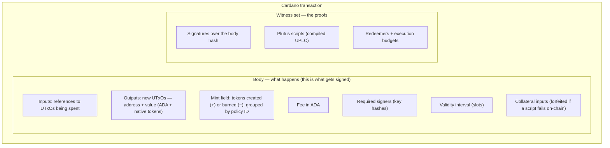
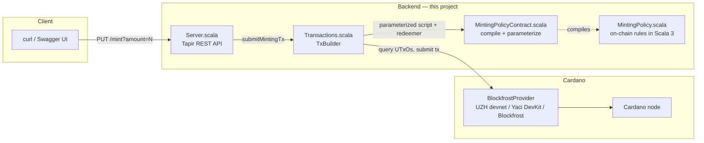
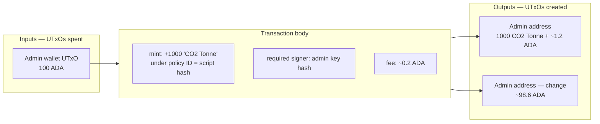
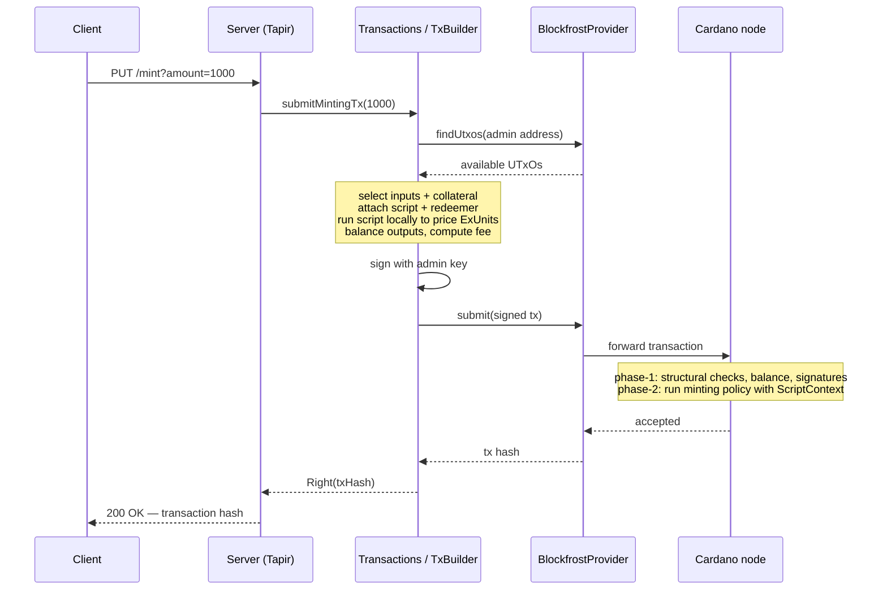
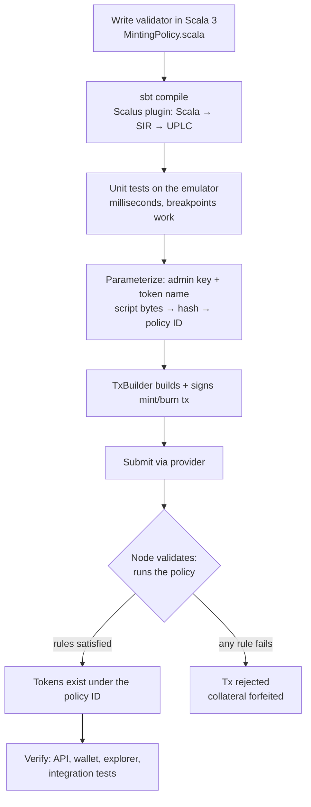

# How This DApp Works

This document explains how the scalus-starter project works end to end: how a Cardano
transaction is structured, how the on-chain minting policy written in Scala 3 gets compiled and
executed by the Cardano node, and how the backend server builds and submits transactions.

It assumes you know the Cardano basics — the eUTxO model and native assets — but not Scalus or
DApp backend architecture.

**What this project is:** a token-minting service. A Plutus V3 *minting policy* (the smart
contract) decides who may mint or burn a token called "CO2 Tonne". A REST backend exposes
`PUT /mint?amount=N`, builds the corresponding transaction, signs it, and submits it to a Cardano
node. On-chain and off-chain code live in one Scala codebase.

## Cardano transactions and Plutus scripts in two minutes

### What a transaction looks like

A Cardano transaction is a *body* plus a *witness set*. The body says what happens; the witness
set proves it is allowed to happen.



Key points:

- Inputs consume existing UTxOs entirely; outputs create new ones. ADA and tokens must balance:
  `sum(inputs) + minted = sum(outputs) + fee + burned`.
- Tokens only ever come into existence through the **mint field**, and every entry in it names a
  *policy ID* — the hash of the script that must approve the change.
- The transaction is built and signed **off-chain**, in our case by the backend. The node never
  builds transactions; it only validates and applies them.

### How Cardano runs a UPLC script

A Plutus script is a compiled function in *Untyped Plutus Core* (UPLC), shipped inside the
transaction's witness set. When a transaction mints under a policy (or spends a script-locked
UTxO), the node applies that function to one argument: the **ScriptContext**, encoded as `Data`
(Plutus's universal serialization format). The ScriptContext contains:

- `TxInfo` — the *entire* transaction being validated: inputs, outputs, mint field, signatories,
  validity interval, and more;
- the **redeemer** — an arbitrary `Data` value the transaction author passes to the script;
- the **script purpose** — *why* the script is being run (minting policy X? spending input Y?).

The node evaluates the function. If it finishes without failing, the transaction is valid; any
failure (an uncaught error) rejects it, and the collateral input is forfeited. Scripts are pure:
they cannot read the chain, call out, or mutate anything — they can only inspect the
ScriptContext and succeed or fail.

In Scalus you see exactly this shape. Our validator's entry point is:

```scala
override inline def mint(param: Data, redeemer: Data, policyId: PolicyId, tx: TxInfo): Unit
```

Scalus generates the plumbing that decodes the raw ScriptContext, dispatches on the script
purpose (here: minting), and calls `mint` with the decoded `TxInfo`. Your job is only to write
the rules.

## Architecture overview



| Component | File | Role |
|-----------|------|------|
| Minting policy | `src/main/scala/starter/MintingPolicy.scala` | On-chain validation rules, compiled to UPLC |
| Contract object | `src/main/scala/starter/MintingPolicyContract.scala` | Compiles the policy, applies parameters, generates the CIP-57 blueprint |
| Transaction builder | `src/main/scala/starter/Transactions.scala` | Builds, signs, submits mint/burn transactions |
| Server + config | `src/main/scala/starter/Server.scala` | REST API (`Server`) and dependency wiring (`AppCtx`) |
| CLI entry points | `src/main/scala/starter/Main.scala` | `start` (Blockfrost), `yaciDevKit` (local), `uzhDevNet` (UZH network) |

## The on-chain contract

`MintingPolicy.scala` enforces three rules for every mint or burn:

1. only the configured token name may be minted or burned;
2. exactly one token type per transaction;
3. the transaction must be signed by the configured admin key.

```scala
@Compile
object MintingPolicy extends DataParameterizedValidator {

    def mintingPolicy(adminPubKeyHash: PubKeyHash, tokenName: TokenName,
                      ownPolicyId: PolicyId, tx: TxInfo): Unit = {
        val mintedTokens = tx.mint.toSortedMap.getOrFail(ownPolicyId, "Tokens not found")
        mintedTokens.toList match
            case Cons((tokName, _), Nil) => require(tokName == tokenName, "Token name not found")
            case Cons(_, _)              => fail("Multiple tokens found")
            case _                       => impossible()
        require(tx.signatories.contains(adminPubKeyHash), "Not signed by admin")
    }
}
```

The `@Compile` annotation makes the Scalus compiler plugin translate this object — at Scala
compile time — into *Scalus Intermediate Representation* (SIR), which
`MintingPolicyContract` then lowers to UPLC:

```scala
val compiled: PlutusV3[Data => Data => Unit] = PlutusV3.compile(MintingPolicy.validate)
```

Because the same Scala code also runs on the JVM, you can unit-test and even step through your
on-chain logic with a debugger — no blockchain required.

### Parameterization: why the admin key can never change

`compiled` above is a UPLC function that still expects one more argument before it becomes a
finished validator: the configuration. `MintingPolicyContract.makeMintingPolicyScript` applies
it:

```scala
def makeMintingPolicyScript(adminPubKeyHash: PubKeyHash, tokenName: TokenName) = {
    val config = MintingConfig(adminPubKeyHash = adminPubKeyHash, tokenName = tokenName)
    compiled(config.toData)   // partially apply the UPLC function to the config
}
```

Applying the argument produces a **new script** whose bytes contain the encoded
`MintingConfig`. And that is the whole trick:

- The **policy ID is the hash of the script bytes**. Since the admin key and token name are part
  of those bytes, they are part of the hash.
- Changing the admin key — or any other parameter — produces different bytes, hence a different
  hash, hence a **different policy ID, i.e. a different token entirely**. Nobody, not even the
  admin, can alter the rules of the existing token: there is no stored configuration to update,
  only an immutable script that the mint field's policy ID must hash-match.
- Anyone can verify the rules: take the published contract code, apply the claimed parameters,
  hash the result, and compare with the policy ID of the token. Same parameters always produce
  the same policy ID.

This is the standard Cardano pattern for configuring contracts, and it is why holders of "CO2
Tonne" tokens can trust that only the admin key that existed at deployment will ever authorize
minting.

## Anatomy of a mint transaction

Minting 1000 tokens produces a transaction like this (amounts illustrative):



The witness set carries the parameterized minting policy script, the redeemer (`Data.unit` — our
policy ignores it), and the admin's signature. Two details worth noticing:

- The token output also holds some ADA: every UTxO must contain a minimum amount of ADA
  proportional to its size (min-ADA rule).
- The admin signature does double duty: it authorizes spending the input UTxO *and* satisfies
  the policy's `signatories.contains(adminPubKeyHash)` check.

**Burning** is the same transaction shape with a negative mint amount: the tokens must be
present in the spent inputs, the mint field says `−1000`, and no token appears in the outputs —
the balance equation destroys them. In the code the only difference is
`makeBurningTx(-1000)` versus `makeMintingTx(1000)` and the absence of a `payTo` with tokens.

## How the backend builds and submits it

`Server.scala` exposes the endpoint; `Transactions.scala` does the work with Scalus's
`TxBuilder`:

```scala
TxBuilder(ctx.cardanoInfo)
    .mint(compiled = ctx.mintingScript, assets = assets, redeemer = Data.unit)
    .requireSignature(ctx.addrKeyHash)
    .payTo(ctx.address, mintedValue)
    .complete(ctx.provider, sponsor = ctx.address)  // UTxO selection, collateral, balancing, fee
    .sign(ctx.signer)
    .transaction
```

Everything you *didn't* write — input selection, collateral, change output, execution-unit
estimation, fee calculation — happens inside `complete()`:



Note that the minting policy runs **twice**: once locally in the builder to measure its
execution budget (scripts are deterministic, so the result is identical), and once on the node
during phase-2 validation. If someone submitted a transaction violating the rules, the node's
run would fail and the transaction would be rejected.

The `BlockfrostProvider` speaks the Blockfrost REST API, which all three supported networks
expose: the UZH devnet, a local Yaci DevKit, and blockfrost.io for public networks. Switching
networks is just a different `AppCtx` factory — the contract and transaction code never change.

## The whole lifecycle



## Try it yourself

### UZH devnet (recommended for this course)

The university hosts a shared Cardano devnet (a Yaci DevKit instance). Start the backend
against it:

```bash
sbt "runMain starter.uzhDevNet"
```

The server starts on port 8088, connected to the UZH network with a pre-funded test wallet.
Then mint your first tokens:

```bash
curl -X PUT "http://localhost:8088/mint?amount=100"
```

The response is a transaction hash. Explore the API interactively in Swagger UI at
<http://localhost:8088/docs>.

Optional environment overrides: `UZH_HOST` (devnet host) and `MNEMONIC` (use your own wallet
instead of the shared test one — with the shared wallet, concurrent submissions from many
students can conflict over UTxOs).

### Local Yaci DevKit

Run your own disposable devnet in Docker (requires Docker and Testcontainers reuse enabled —
see `integration/src/test/scala/starter/TestcontainersReuse.scala`):

```bash
sbt "integration/Test/runMain starter.YaciDevKitMain"   # starts the devnet, prints API URLs
sbt "runMain starter.yaciDevKit"                        # starts the backend against it
```

### Public testnet via Blockfrost

```bash
export BLOCKFROST_API_KEY="your key from blockfrost.io"
export MNEMONIC="your 24-word seed phrase"
sbt "runMain starter.start"
```

## Testing strategy

| Level | Command | What runs |
|-------|---------|-----------|
| Unit | `sbt test` | Contract logic on the Scalus **emulator** — no blockchain, milliseconds per test, debugger-friendly. Covers wrong token names, missing/wrong signatures, multi-token mints, and script size. |
| Integration | `sbt integration/test` | The full lifecycle — build, submit, confirm, burn — against a real node in Docker (Yaci DevKit via Testcontainers). |

The unit tests are where you will spend most of your time: because the validator is plain Scala,
a failing rule is a red test with a stack trace, not a cryptic on-chain error.

## Exercises

1. **Max supply.** Extend `MintingPolicy` so total mints cannot exceed a configured cap
   (add a field to `MintingConfig`). Watch the policy ID change when the config changes.
2. **Burn endpoint.** Add `PUT /burn?amount=N` to `Server.scala` using the existing
   `makeBurningTx`.
3. **Blueprint.** Run `sbt "run blueprint"` and inspect the CIP-57 JSON — find the compiled
   UPLC and the script hash you learned about above.
4. **Break a rule.** Change the token name in a test to something not in the config and watch
   both the emulator test and (if you submit it) the node reject it.
